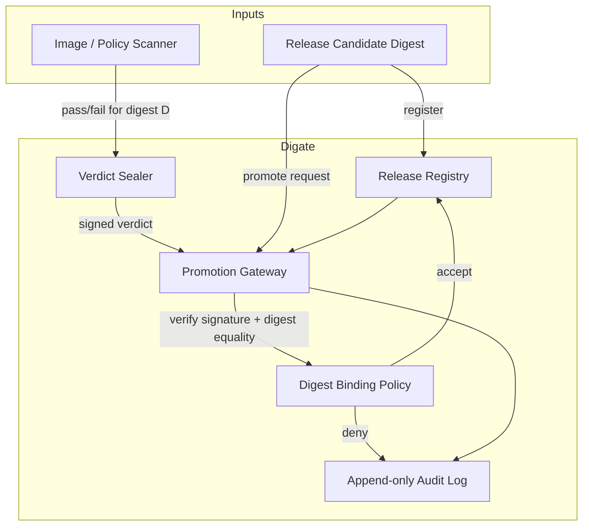

# Digate

Digest-bound release promotion for agentic and CI delivery pipelines.

Reviewers stop citing yesterday's passing scan for today's build. Digate only
promotes a release when a trusted scanner seal matches the **exact** candidate
digest under consideration.

## Architecture



## What this MVP proves

A valid signature on the wrong digest leaves release state unchanged.

1. Register today's candidate digest
2. Present a passing seal that was issued for yesterday's digest
3. Promotion is denied and state stays `candidate`
4. Present a seal for today's digest and promotion succeeds

## Requirements

- Python 3.11+
- `pip`

## Setup

```bash
git clone https://github.com/AIFrontiersLab/digate.git
cd digate

python -m venv .venv
source .venv/bin/activate
pip install -r requirements.txt
```

## Demo

```bash
python -c "from main import demo; demo()"
# or
python -m digate demo
```

## Run the API

```bash
uvicorn main:app --host 0.0.0.0 --port 8000
```

Interactive docs: `http://127.0.0.1:8000/docs`

## API reference

### `GET /health`

```bash
curl -s http://127.0.0.1:8000/health
```

### `POST /candidates`

Register the digest that may later be promoted.

```bash
curl -s http://127.0.0.1:8000/candidates \
  -H 'content-type: application/json' \
  -d '{"release_id":"rel-100","digest":"<sha256 hex>","image_ref":"app:1.0.0-rc2"}'
```

### `POST /verdicts`

Issue a signed scan verdict bound to a digest.

```bash
curl -s http://127.0.0.1:8000/verdicts \
  -H 'content-type: application/json' \
  -d '{"release_id":"rel-100","digest":"<sha256 hex>","outcome":"pass"}'
```

### `POST /promote`

Attempt promotion. Mismatched digests return HTTP 409 and leave state unchanged.

```bash
curl -s http://127.0.0.1:8000/promote \
  -H 'content-type: application/json' \
  -d '{"release_id":"rel-100","candidate_digest":"<sha256 hex>","verdict":{...}}'
```

### `GET /releases/{release_id}`

```bash
curl -s http://127.0.0.1:8000/releases/rel-100
```

### `GET /audit`

```bash
curl -s http://127.0.0.1:8000/audit
```

## CLI

```bash
python -m digate digest --text "build-today"
python -m digate register --release-id rel-100 --digest <hex>
python -m digate seal --release-id rel-100 --digest <hex> --out verdict.json
python -m digate promote --release-id rel-100 --digest <hex> --verdict verdict.json
python -m digate status --release-id rel-100
```

## Tests

```bash
pytest -q
```

## Project layout

```text
.
├── README.md
├── LICENSE
├── main.py
├── requirements.txt
├── pyproject.toml
├── pytest.ini
├── digate/
│   ├── __init__.py
│   ├── __main__.py
│   ├── api.py
│   ├── audit.py
│   ├── cli.py
│   ├── config.py
│   ├── crypto.py
│   ├── demo.py
│   ├── errors.py
│   ├── gateway.py
│   ├── hashing.py
│   ├── models.py
│   ├── policy.py
│   ├── store.py
│   └── verdict.py
├── docs/
│   ├── architecture.md
│   └── assertion.md
├── fixtures/
│   └── candidates.json
└── tests/
    ├── conftest.py
    ├── test_api.py
    ├── test_assertion.py
    ├── test_crypto.py
    ├── test_gateway.py
    ├── test_hashing.py
    ├── test_policy.py
    ├── test_store.py
    └── test_verdict.py
```

## Design notes

- Seals cover a canonical JSON payload that includes `digest`, `outcome`, and `release_id`.
- The gateway compares verdict digest to candidate digest before mutating state.
- Local Ed25519 keys are generated under `data/keys/` for demos; production should inject keys from a KMS or signer service.
