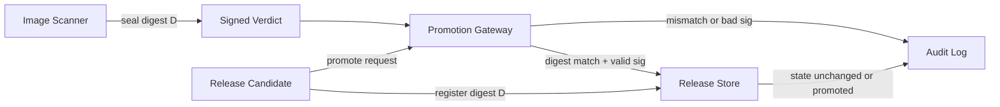

# Digate architecture notes

Digate is a Phase-1 promotion gateway. Scanners seal pass/fail outcomes to a
candidate digest. The gateway only advances release state when the seal matches
the exact digest under promotion.

## Components

| Component | Responsibility |
| --- | --- |
| Release Store | Tracks candidate/promoted digests |
| Verdict Sealer | Ed25519 seals over canonical scan payload |
| Policy | Digest binding, freshness, release binding |
| Gateway | Orchestrates verify-then-act |
| Audit Log | Append-only deny/accept events |
